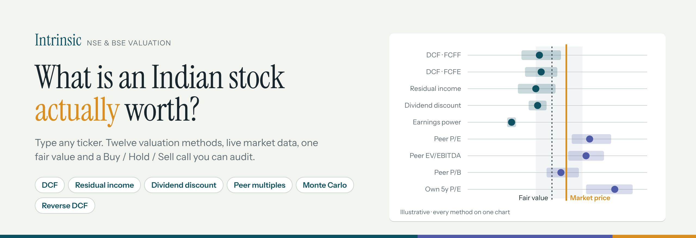
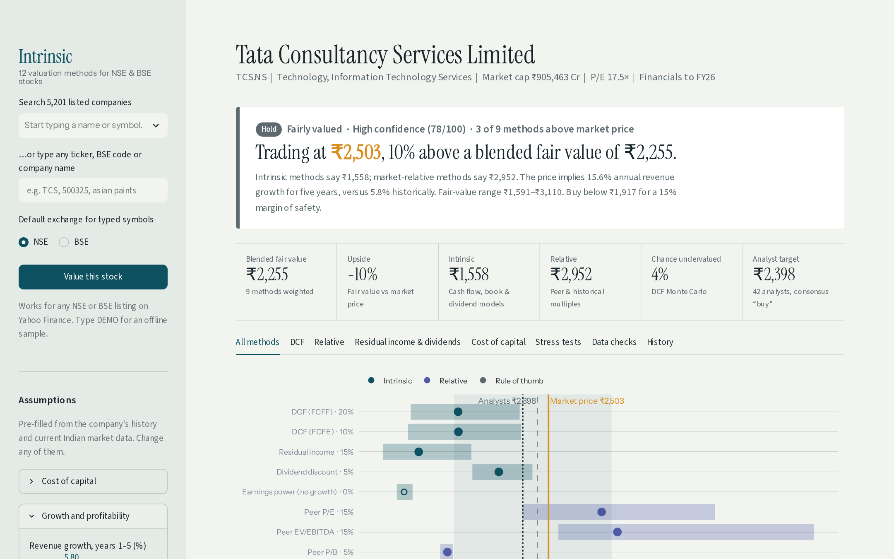
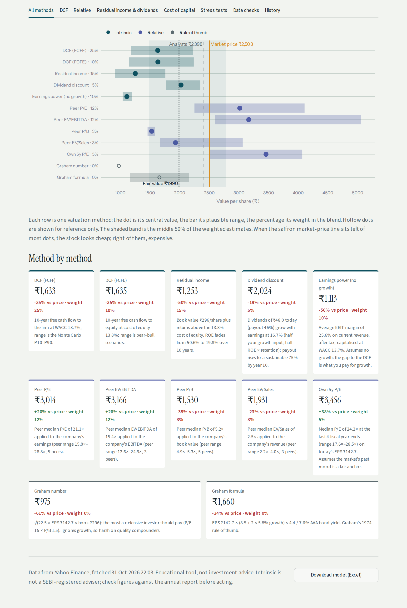
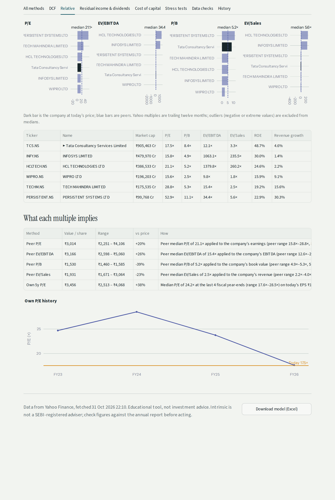
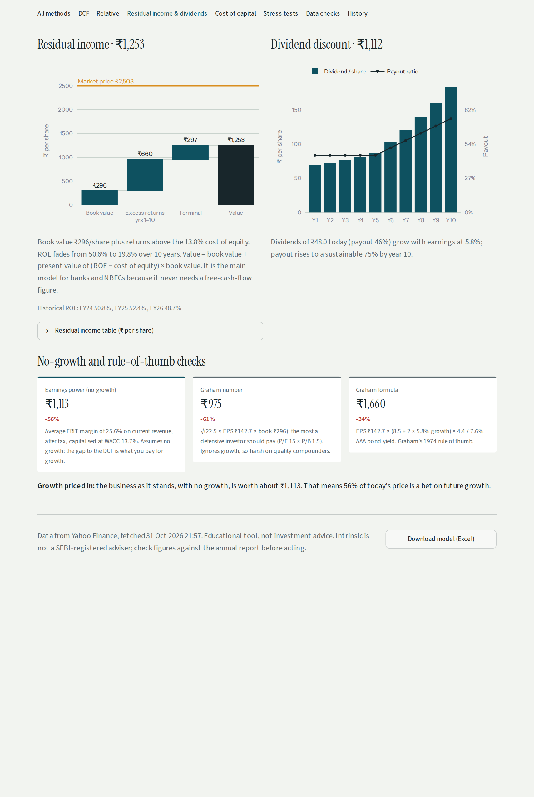
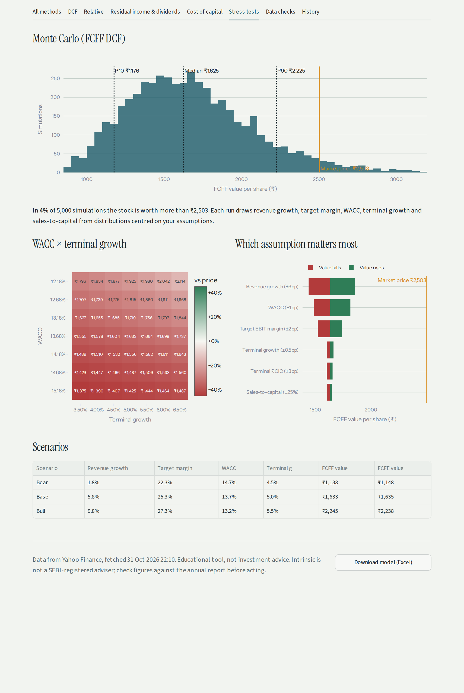
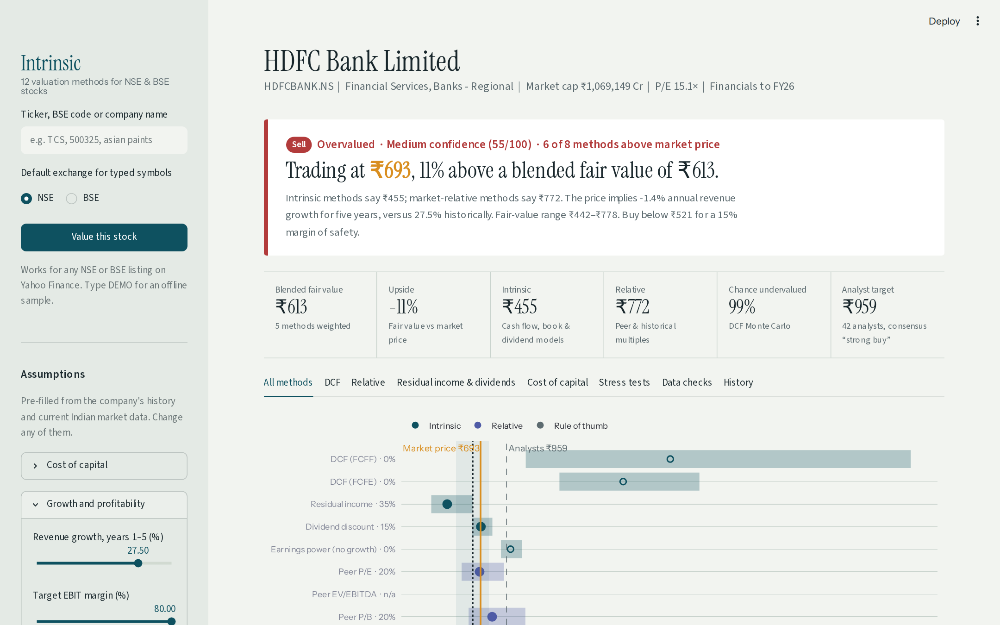
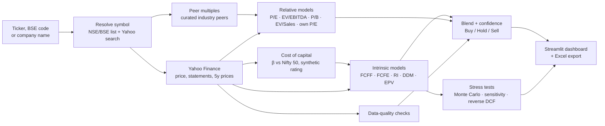

<p align="center">
  
</p>

<p align="center">
  <a href="https://github.com/PalakGupta7456/stock-valuation-india/actions/workflows/ci.yml"></a>
  <a href="https://github.com/PalakGupta7456/stock-valuation-india/actions/workflows/live-check.yml"></a>
  
  
  
</p>

**Intrinsic** values any company listed on the **NSE or BSE** using **live market data** and **twelve valuation methods** — discounted cash flow, residual income, dividend discount, earnings power, peer multiples, the stock's own history and Graham's rules — then blends them into one fair value, compares it with the market price and gives a **Buy / Hold / Sell** call with a confidence score that is honest about how far the numbers can be trusted.

Search by name ("asian paints"), NSE symbol (`ASIANPAINT`) or BSE code (`500820`). Every result has a shareable link, e.g. `/?ticker=TCS`.



---

## Highlights

- **Any listed Indian company.** A searchable list of every NSE (and BSE-only) company, refreshed weekly from the exchanges, plus name search through Yahoo Finance. Automatic NSE ↔ BSE fallback and a trailing-twelve-month fallback when a small cap has no annual statements.
- **Twelve methods on one chart.** A football-field chart shows each method's value and range against the market price, so you see agreement or disagreement at a glance.
- **Sector-aware.** For banks, NBFCs and insurers, cash-flow DCFs and EV multiples are switched off and the blend leans on residual income, P/B, P/E and dividends.
- **Honest confidence.** The score drops for thin or stale data and when methods disagree, for example when cash-flow models and peer multiples are more than 2× apart, and strong calls are toned down when confidence is low.
- **Indian cost of capital.** 10-year G-sec, India equity risk premium, beta regressed against the Nifty 50, synthetic credit rating, Sec 115BAA tax rate.
- **Stress-tested.** Vectorised 5,000-run Monte Carlo, WACC × growth heatmap, tornado chart, bear/base/bull scenarios and a reverse DCF ("what growth is the price assuming?").
- **Fully editable.** Every assumption, the peer group and the weight of each method can be changed in the sidebar.
- **Exportable.** One-click Excel workbook with every model, table and check.
- **Tested against real stocks.** A GitHub Action values ~30 live tickers (large, mid and small caps, banks, NBFCs, insurers, BSE codes, loss-makers) on every push and every week. **[See the latest live run →](reports/live_check.md)**

## The twelve methods

| Family | Method | What it answers |
|---|---|---|
| **Intrinsic** | DCF: free cash flow to the firm | What are the operating cash flows worth at the company's WACC? |
| | DCF: free cash flow to equity | What is left for shareholders after debt, at the cost of equity? |
| | Residual income | Book value + present value of returns above the cost of equity. Lead model for lenders. |
| | Dividend discount | Future dividends, with payout converging to a sustainable level. |
| | Earnings power value | Today's business with **zero** growth: the gap to the price is the growth bet. |
| **Relative** | Peer P/E, EV/EBITDA, P/B, EV/Sales | What would the stock trade at on its peers' median multiples? |
| | Own 5-year P/E | What would it trade at on its own historical multiple? |
| **Rule of thumb** | Graham number, Graham formula | Benjamin Graham's defensive ceilings (reference only). |

Formulas, defaults and the confidence rules are in **[docs/METHODOLOGY.md](docs/METHODOLOGY.md)**.

## Screenshots

| Every method on one chart | Peer comparison |
|---|---|
|  |  |
| **Residual income, dividends, no-growth value** | **Stress tests** |
|  |  |

**Banks are valued differently.** For HDFC Bank, cash-flow DCFs and EV multiples are switched off (hollow dots, 0% weight) and residual income, P/B, P/E and dividends drive the verdict:



<sub>Screenshots are regenerated from live data by the <code>Refresh screenshots</code> workflow.</sub>

## How it works



## Quick start

```bash
git clone https://github.com/PalakGupta7456/stock-valuation-india.git
cd stock-valuation-india
python -m venv .venv && source .venv/bin/activate      # Windows: .venv\Scripts\activate
pip install -r requirements.txt
streamlit run app.py
```

Open http://localhost:8501 and search for any company, or type `DEMO` for an offline sample.

### From Python

```python
from valuation import fetch_company, value_company, Assumptions
from valuation.peers import suggest_peers, fetch_peer_multiples

c = fetch_company("TCS.NS")
peers = fetch_peer_multiples(suggest_peers(c.ticker, c.industry))
rep = value_company(c, Assumptions(growth_high=0.09), peers)

print(rep.verdict.rating, round(rep.verdict.fair_value), f"{rep.verdict.upside:+.0%}")
print(rep.method_table[["Method", "Value", "Upside", "Weight"]])
```

### Value a basket from the command line

```bash
python scripts/live_check.py TCS HDFCBANK ITC 500325      # writes reports/live_check.md
```

### Deploy free on Streamlit Community Cloud

1. Sign in at [share.streamlit.io](https://share.streamlit.io) with GitHub.
2. **Create app → Deploy a public app from GitHub**, pick this repo, branch `main`, file `app.py`.
3. Paste the app URL at the top of this README.

## Project structure

```
app.py                       Streamlit dashboard
valuation/
  data.py                    Yahoo Finance fetch, retries, NSE↔BSE and TTM fallbacks, name search
  universe.py                Searchable list of listed companies
  peers.py                   Curated Indian peer groups and peer multiples
  wacc.py                    Regression beta, synthetic rating, CAPM, WACC
  dcf.py                     Vectorised FCFF / FCFE engine
  methods.py                 Residual income, DDM, EPV, Graham, peer and historical multiples
  analysis.py                Sensitivity, tornado, scenarios, Monte Carlo, reverse DCF
  quality.py                 Data-quality checks that lower confidence
  recommend.py               Blend, consensus, confidence and rating
  export.py                  Excel export
  config.py                  Market defaults and method weights
scripts/
  live_check.py              Values a basket of real stocks (used in CI)
  update_symbols.py          Rebuilds the NSE/BSE company list
  screenshots.py             Regenerates README screenshots from live data
tests/                       39 unit tests with closed-form checks
.github/workflows/           CI · live data check · company list refresh · screenshots
```

## Engineering notes

- **Correctness first.** Each model is unit-tested against a closed-form case: zero-growth DCF equals a perpetuity, unlevered FCFE equals FCFF, residual income equals book value when ROE = cost of equity, the DDM collapses to Gordon growth, reverse DCF recovers the growth that generated the price.
- **One vectorised engine.** The same NumPy DCF powers the base case, scenarios, the 7 × 7 sensitivity grid and 5,000 Monte Carlo runs in milliseconds.
- **Graceful degradation.** Every method returns a value *or* a plain-English reason it doesn't apply; the blend re-weights over what works instead of failing.
- **Continuous verification.** Unit tests, lint and an app smoke test run on Python 3.11–3.13; a separate workflow checks live data weekly.

## Limitations

- Yahoo Finance provides ~4 years of statements and is thinner for small caps and lenders. Verify key figures against the annual report.
- Peer groups are curated by industry; edit them in the sidebar for unusual businesses.
- Market defaults (G-sec, ERP, AAA yield) live in `valuation/config.py` and should be refreshed when rates move.
- **Educational project, not investment advice.** Not a SEBI-registered research analyst or adviser.

## Roadmap

- [ ] Screener.in / exchange filings as a second source for 10-year history and better bank data
- [ ] Live G-sec yield and India ERP
- [ ] Sum-of-the-parts for conglomerates and holding companies
- [ ] Bank-specific metrics (NIM, GNPA, CASA, capital adequacy)
- [ ] Watchlist: value many tickers and rank by upside × confidence
- [ ] Backtest of past ratings against 12-month returns

## License

[MIT](LICENSE) © 2026 Palak Gupta
